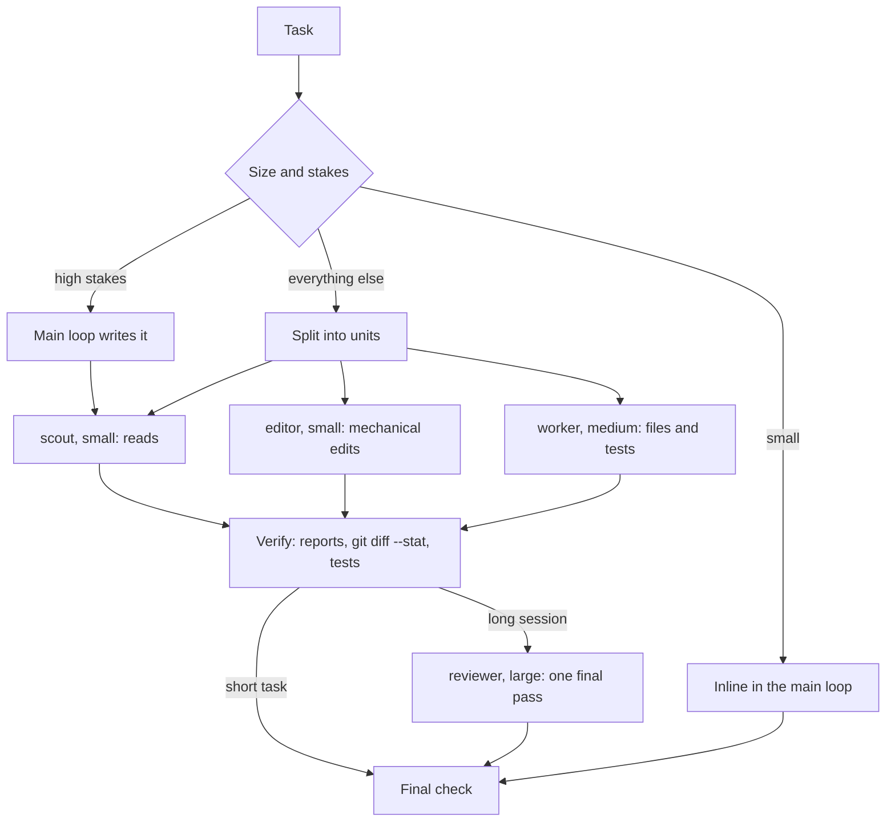

# cheap-orchestration

**Decide what a coding agent session delegates, to which model tier, and when
it should not delegate at all.**

A session on a large model pays for every token it reads, on every later
turn. Handing a unit of work to a subagent keeps that reading out of the main
context, and pinning the subagent to a cheaper model cuts the bill again. It
also costs some quality. This skill holds the rule that arbitrates between
the two, the spec templates that make a delegation worth its overhead, and
the benchmark numbers behind each rule.

> **Benchmarked, not guessed.** 313 Claude Code sessions, 607.50 $ of API
> usage, 18 configurations. On a long session, a Sonnet worker with a final
> Opus review costs **58% less** than no delegation (1.36 $ against 3.22 $)
> for **0.26 of a point less** judged quality out of 5. The interactive
> report and every run are in
> [benchmarks/cheap-orchestration](../../benchmarks/cheap-orchestration/).

It ships the four agent definitions and a setup script that installs them
for Claude Code, Codex CLI or Gemini CLI. See
[Configuration](#-configuration).

---

## 🚀 Features

| | Feature | What it gives you |
|---|---|---|
| ⚖️ | **Decision rule** | Inline, write it yourself, or delegate, decided by task size and stakes |
| 👥 | **Pinned crew** | Four agents (`scout`, `editor`, `worker`, `reviewer`), each tied to one model tier (`small`, `medium`, `large`) |
| 🧩 | **Model agnostic** | Rules name tiers; one table maps them to Claude, GPT and Gemini |
| 🛠️ | **Setup script** | Installs the crew for Claude Code, Codex CLI or Gemini CLI, dry run by default |
| 🏷️ | **Model label** | Every delegation starts its description with the model in brackets: `[Haiku]`, `[Terra]`, `[Carbon]` |
| 🧱 | **Guards** | Binding order between units, one test per requirement, `path:line` re-check |
| 📝 | **Templates** | Spec and return formats for each agent, sized to keep reports short |
| 📊 | **Evidence** | A published benchmark of 313 sessions, with the number that backs each rule |

---

## ⚡ Quickstart

```bash
npx skills add obeone/claude-skills -g --skill cheap-orchestration -y
cd ~/.claude/skills/cheap-orchestration
uv run scripts/setup_crew.py --provider claude          # dry run
uv run scripts/setup_crew.py --provider claude --apply  # install the crew
```

Then paste [assets/delegation-and-cost.md](./assets/delegation-and-cost.md)
into your instruction file, and invoke the skill when planning a task:

```text
/cheap-orchestration
```

### Setup commands

| Command | Effect |
|---|---|
| `uv run scripts/setup_crew.py --provider <p>` | Dry run: prints what would be written, writes nothing |
| `... --apply` | Writes the four definitions, keeps any existing file that differs |
| `... --apply --force` | Replaces existing definitions |
| `... --scope project` | Targets the current repository instead of the home directory |
| `... --check` | Exits 1 if a crew agent is missing |
| `... --medium <model>` | Replaces a model identifier (`--small`, `--large` likewise) |

`<p>` is `claude`, `codex` or `gemini`.

---

## 📦 Installation

### Recommended: the `skills` CLI

```bash
# User-global (available in every project)
npx skills add obeone/claude-skills -g --skill cheap-orchestration -y

# Project-scoped (./.claude/skills)
npx skills add obeone/claude-skills --skill cheap-orchestration -y
```

Update with `npx skills update cheap-orchestration`, remove with
`npx skills remove cheap-orchestration`.

### Other routes

Uploading in claude.ai, unpacking a release bundle by hand, or installing
from a source checkout are covered in the repository
[Installation](../../README.md#-installation) section.

### Verify

```bash
head -6 ~/.claude/skills/cheap-orchestration/SKILL.md
# expect: name: cheap-orchestration, then metadata.version: 2.3.1 (or higher)
```

### Requirements

| Requirement | Why |
|---|---|
| **A harness with subagents** | Claude Code, Codex CLI or Gemini CLI: something must launch an agent on a pinned model |
| **`uv`** on `$PATH` ([install](https://astral.sh/uv/)) | Runs `setup_crew.py`, which is standard library only |
| **The crew installed** | `setup_crew.py --apply` writes the four definitions; without them the units stay inline |
| **A "Delegation & cost" section** in your `CLAUDE.md` or `AGENTS.md` | The operative rules live there, the skill is the detail and the rationale |

---

## 🔧 Configuration

The skill ships the four agent definitions and the rule text, and installs
neither on its own: run the setup once per harness.

### Tiers

The rules name tiers, not models. Map each tier to your provider once:

| Tier | Claude | GPT | Gemini |
|---|---|---|---|
| `large` | Opus | Sol | Carbon |
| `medium` | Sonnet | Terra | Neon |
| `small` | Haiku | Luna | Hydrogen |

The main loop usually runs on `large`.

### The crew

Four agents, each with its model pinned in its own definition. None can
launch agents, so no subagent can fan out on its own.

| Agent | Tier | Tools | Use for | Returns |
|---|---|---|---|---|
| `scout` | small | read, search, read-only shell | Questions about the code before a decision or a spec | 15 lines of `path:line` facts |
| `editor` | small | edits, shell | Mechanical edits with no design choice | 10-line report |
| `worker` | medium | edits, shell | Every other unit whose output is files | 10-line report |
| `reviewer` | large | edits, shell | Final restriction check and polish pass on long sessions | 10-line report |

The definitions ship in [assets/agents/](./assets/agents/) and
`scripts/setup_crew.py` renders them for your harness:

| Provider | Written to | Format | Models (small, medium, large) |
|---|---|---|---|
| `claude` | `~/.claude/agents/<name>.md` | Markdown, YAML front-matter | `haiku`, `sonnet`, `opus` |
| `codex` | `~/.codex/agents/<name>.toml` | TOML | `gpt-6-luna`, `gpt-6.1-terra`, `gpt-6.2-sol` |
| `gemini` | `~/.gemini/agents/<name>.md` | Markdown, YAML front-matter | `gemini-4-hydrogen`, `gemini-4-neon`, `gemini-4-carbon` |

The Codex layout was checked by Codex against its CLI 0.171.0. The Gemini
layout is as reported by Gemini and was not run against an installed CLI;
subagents are experimental there and need `experimental.enableAgents`.
Per-harness limits (sandbox inheritance on Codex, tool inheritance on
Gemini): [references/harnesses.md](./references/harnesses.md).

Never override the model at call time: the pin is the cost boundary. If an
agent is missing, its units stay inline; the skill never falls back to an
agent that inherits the session model.

### The rules

The rule text that the main loop follows belongs in the instruction file
your harness loads every session (`CLAUDE.md`, `AGENTS.md`). It ships as
[assets/delegation-and-cost.md](./assets/delegation-and-cost.md), stated by
tier: paste it in and replace the tier placeholders in the label examples
with your model names. The script never edits your instruction file.

### Optional deny list (Claude Code)

The built-in agents `general-purpose`, `Explore`, `Plan` and `claude` inherit
the session model, so under a large-tier session they bill
the large tier. Denying them in
`settings.json` blocks those four targets. It does not stop other
user-defined or plugin agents, and any skill that launches `general-purpose`
stops working until the deny is lifted.

---

## ⚖️ Decision rule

First match wins.

| # | Case | What to do | Why |
|---|---|---|---|
| 1 | One command, an edit of about 10 lines in one file, reasoning on output in hand | Inline | A delegation costs a spec, a launch turn, a notification turn and the agent's own system prompt |
| 2 | Published code others depend on, security, irreversible operations, quality before cost | Write it yourself, delegate only reads and mechanical sweeps | Delegation costs 0.3 to 0.5 of 5 in judged quality, whatever the worker model |
| 3 | Everything else, short or long | Delegate each unit to `scout`, `editor` or `worker` | Long sessions save about 65% with a medium-tier worker, short tasks about 40% |
| 4 | Long multi-part session | One final `reviewer` pass | Recovers about 0.2 of the 0.47 quality gap for 0.20 $ |

---

## 📊 Evidence

Measured in 2026-10 on Claude models only (Opus 5.5 main loop, so Opus is
`large`, Sonnet `medium`, Haiku `small`), over a long three-part session and a shorter three-part task. Quality
is the mean of three blind judge ratings out of 5.

| Setup | Cost vs no delegation | Quality |
|---|---|---|
| Delegation, all-Opus crew, long session | -53% | about -0.3 of 5 |
| Delegation, Sonnet worker, long session | -64% (1.15 $ vs 3.22 $) | 3.83 vs 4.31 |
| Same, plus a final Opus reviewer | -58% (1.36 $) | 4.04 |
| Short task, Opus subagents | about 0% | about -0.3 of 5 |
| Short task, pinned cheaper agents | about -40% | about -0.3 of 5 |

These numbers hold for that model family and its price grid. On GPT or
Gemini the reasoning transfers, the percentages are unverified.

Full table, failures and what was dropped from v1:
[references/evidence.md](./references/evidence.md). Interactive report,
configuration legend and per-run dataset:
[benchmarks/cheap-orchestration](../../benchmarks/cheap-orchestration/).

---

## 📚 Deeper documentation

| File | Content |
|---|---|
| [SKILL.md](./SKILL.md) | Crew, decision rule, workflow |
| [references/templates.md](./references/templates.md) | Spec and return templates for each agent |
| [references/evidence.md](./references/evidence.md) | Benchmark findings, built-in agents, v1 leftovers |
| [references/harnesses.md](./references/harnesses.md) | Agent format, paths, models and limits per harness |
| [assets/delegation-and-cost.md](./assets/delegation-and-cost.md) | Rule text for your instruction file |

---

## 🏗️ Architecture



---

## 📄 License

MIT, see the repository [LICENSE](../../LICENSE).

---

*Built with 🤖 by autonomous agents, for autonomous agents.*

Made by Grégoire Compagnon ([obeone](https://github.com/obeone))
