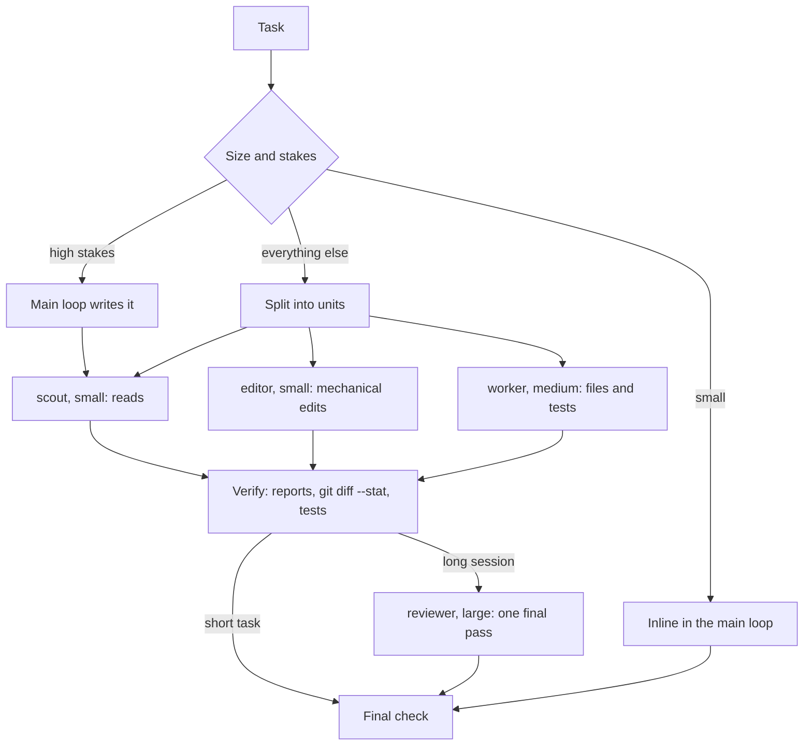

# cheap-orchestration

**Decide what a coding agent session delegates, to which model tier, and when
it should not delegate at all.**

A session on a large model pays for every token it reads, on every later
turn. Handing a unit of work to a subagent keeps that reading out of the main
context, and pinning the subagent to a cheaper model cuts the bill again. It
also costs some quality. This skill holds the rule that arbitrates between
the two, the spec templates that make a delegation worth its overhead, and
the benchmark numbers behind each rule.

It is a documentation skill: no scripts, no validators. It is also not
self-contained, see [Configuration](#-configuration) before installing.

---

## 🚀 Features

| | Feature | What it gives you |
|---|---|---|
| ⚖️ | **Decision rule** | Inline, write it yourself, or delegate, decided by task size and stakes |
| 👥 | **Pinned crew** | Four agents (`scout`, `editor`, `worker`, `reviewer`), each tied to one model tier (`small`, `medium`, `large`) |
| 🧩 | **Model agnostic** | Rules name tiers; one table maps them to Claude, GPT and Gemini |
| 🏷️ | **Model label** | Every delegation starts its description with the model in brackets: `[Haiku]`, `[Terra]`, `[Pro]` |
| 🧱 | **Guards** | Binding order between units, one test per requirement, `path:line` re-check |
| 📝 | **Templates** | Spec and return formats for each agent, sized to keep reports short |
| 📊 | **Evidence** | 277 benchmark runs, with the number that backs each rule |

---

## ⚡ Quickstart

```bash
npx skills add obeone/claude-skills -g --skill cheap-orchestration -y
```

Then create the four agents and add the rules to your instruction file, as
described in [Configuration](#-configuration). Once that is done, invoke it
when planning a task:

```text
/cheap-orchestration
```

---

## 📦 Installation

### Recommended: the `skills` CLI

```bash
# User-global (available in every project)
npx skills add obeone/claude-skills -g --skill cheap-orchestration -y

# Project-scoped (./.claude/skills)
npx skills add obeone/claude-skills --skill cheap-orchestration -y
```

Update with `npx skills update cheap-orchestration`, remove with
`npx skills remove cheap-orchestration`.

### Other routes

Uploading in claude.ai, unpacking a release bundle by hand, or installing
from a source checkout are covered in the repository
[Installation](../../README.md#-installation) section.

### Verify

```bash
head -6 ~/.claude/skills/cheap-orchestration/SKILL.md
# expect: name: cheap-orchestration, then metadata.version: 2.2.0 (or higher)
```

### Requirements

| Requirement | Why |
|---|---|
| **A harness with subagents** | Something must launch an agent on a pinned model. The examples use Claude Code and its `Agent` tool |
| **Four agent definitions** (in Claude Code, `~/.claude/agents/`) | The skill names them, it does not create them |
| **A "Delegation & cost" section** in your `CLAUDE.md` or `AGENTS.md` | The operative rules live there, the skill is the detail and the rationale |

---

## 🔧 Configuration

The skill ships neither the agents nor the rule text. Without them, the
first delegated unit asks for an agent type that does not exist.

### Tiers

The rules name tiers, not models. Map each tier to your provider once:

| Tier | Claude | GPT | Gemini |
|---|---|---|---|
| `large` | Opus | Sol | Pro |
| `medium` | Sonnet | Terra | Flash |
| `small` | Haiku | Luna | Flash-Lite |

The main loop usually runs on `large`.

### The crew

Define four agents, each with its model pinned in its own definition. Give
none of them the ability to launch agents, so no subagent can fan out on its
own.

| Agent | Tier | Tools | Use for | Returns |
|---|---|---|---|---|
| `scout` | small | read, search, read-only shell | Questions about the code before a decision or a spec | 15 lines of `path:line` facts |
| `editor` | small | edits, shell | Mechanical edits with no design choice | 10-line report |
| `worker` | medium | edits, shell | Every other unit whose output is files | 10-line report |
| `reviewer` | large | edits, shell | Final restriction check and polish pass on long sessions | 10-line report |

In Claude Code, an agent is one file in `~/.claude/agents/` with the model in
its front-matter. A minimal `scout.md`:

```markdown
---
name: scout
description: Read-only code scout. Answers questions about the code with path:line facts. Never edits.
model: haiku
tools: Read, Grep, Glob, Bash
---

Answer the question in at most 15 lines of facts, each with a path:line.
Never return file contents. Never edit anything.
```

On another harness, use its own agent or profile mechanism and pin the
matching tier there. Never override the model at call time: the pin is the
cost boundary.

### The rules

The rule text that the main loop follows belongs in the instruction file your harness
loads every session (`CLAUDE.md`, `AGENTS.md`), under a "Delegation & cost" section. [SKILL.md](./SKILL.md) states the
decision rule and the workflow in a form you can adapt.

### Optional deny list (Claude Code)

The built-in agents `general-purpose`, `Explore`, `Plan` and `claude` inherit
the session model, so under a large-tier session they bill
the large tier. Denying them in
`settings.json` blocks those four targets. It does not stop other
user-defined or plugin agents, and any skill that launches `general-purpose`
stops working until the deny is lifted.

---

## ⚖️ Decision rule

First match wins.

| # | Case | What to do | Why |
|---|---|---|---|
| 1 | One command, an edit of about 10 lines in one file, reasoning on output in hand | Inline | A delegation costs a spec, a launch turn, a notification turn and the agent's own system prompt |
| 2 | Published code others depend on, security, irreversible operations, quality before cost | Write it yourself, delegate only reads and mechanical sweeps | Delegation costs 0.3 to 0.5 of 5 in judged quality, whatever the worker model |
| 3 | Everything else, short or long | Delegate each unit to `scout`, `editor` or `worker` | Long sessions save about 65% with a medium-tier worker, short tasks about 40% |
| 4 | Long multi-part session | One final `reviewer` pass | Recovers about 0.2 of the 0.47 quality gap for 0.20 $ |

---

## 📊 Evidence

Measured in 2026-10 on Claude models only (Opus 5.5 main loop, so Opus is
`large`, Sonnet `medium`, Haiku `small`), over a long three-part session and a shorter three-part task. Quality
is the mean of three blind judge ratings out of 5.

| Setup | Cost vs no delegation | Quality |
|---|---|---|
| Delegation, all-Opus crew, long session | -53% | about -0.3 of 5 |
| Delegation, Sonnet worker, long session | -64% (1.15 $ vs 3.22 $) | 3.83 vs 4.31 |
| Same, plus a final Opus reviewer | -58% (1.36 $) | 4.04 |
| Short task, Opus subagents | about 0% | about -0.3 of 5 |
| Short task, pinned cheaper agents | about -40% | about -0.3 of 5 |

These numbers hold for that model family and its price grid. On GPT or
Gemini the reasoning transfers, the percentages are unverified.

Full table, failures and what was dropped from v1:
[references/evidence.md](./references/evidence.md).

---

## 📚 Deeper documentation

| File | Content |
|---|---|
| [SKILL.md](./SKILL.md) | Crew, decision rule, workflow |
| [references/templates.md](./references/templates.md) | Spec and return templates for each agent |
| [references/evidence.md](./references/evidence.md) | Benchmark findings, built-in agents, v1 leftovers |

---

## 🏗️ Architecture



---

## 📄 License

MIT, see the repository [LICENSE](../../LICENSE).

---

*Built with 🤖 by autonomous agents, for autonomous agents.*

Made by Grégoire Compagnon ([obeone](https://github.com/obeone))
